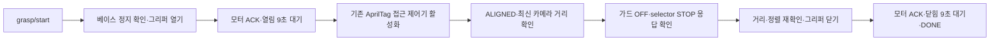

# 팔로워 자동 인식·접근·집기: 2026-10-27 실기 인계

팔로워에서 시작 서비스 한 번으로 AprilTag 인식 → 중심 정렬·접근 → 거리 확인 → 베이스 정지 → 그리퍼 집기까지 검증했다. 사용자도 실제 집기 결과를 확인했다. 이번 시연에는 리프트를 사용하지 않는다. 리더는 아래 서비스와 상태를 참고해 시작·취소를 연결할 수 있다. **리더가 명령을 보내는 통합 운용은 다음 검증 대상이며, 이번 결과는 팔로워 단독 운용이다.**

## 실행

검증 작업공간은 `~/damgc_robot_mission`, ROS 배포판은 Humble이다. 다른 checkout을 사용할 때는 작업공간 경로를 바꾼다.

```bash
cd ~/damgc_robot_mission
source /opt/ros/humble/setup.bash
colcon build --symlink-install --packages-select \
  rescue_robot_tools follower_supply_perception follower_approach_control follower_control
source install/setup.bash
ros2 launch follower_supply_perception follower_apriltag_drive.launch.py
```

위 선택 빌드는 기존 작업공간의 나머지 의존 패키지가 설치된 환경 기준이다. 새 작업공간에서는 먼저 전체 의존 패키지를 빌드한다. launch는 `/dev/video0` 카메라, `/dev/ttyUSB0` U2D2, `/dev/i2c-7`의 STM32 bridge를 사용한다.

별도 터미널에서 같은 환경을 source한 뒤 실행한다.

```bash
# 한 번 호출하면 열기부터 집기까지 자동 실행
ros2 service call /follower/grasp/start std_srvs/srv/Trigger '{}'

# 진행·완료 확인
ros2 topic echo /follower/sequence/status

# 취소: 베이스 정지, 그리퍼는 마지막 목표 유지
ros2 service call /follower/grasp/cancel std_srvs/srv/Trigger '{}'
```

시작 서비스의 `success=true`는 접수 성공이다. 집기 완료는 상태 토픽의 `DONE`으로 구분한다. 실행 중 중복 시작은 거부한다. 완료 후 새 시작 명령이 오기 전에는 태그가 다시 나타나도 열리지 않는다.

## 자동 순서와 리더 인터페이스



| 인터페이스 | 형식 | 의미 |
|---|---|---|
| `/follower/grasp/start` | `std_srvs/srv/Trigger` | 팔로워 단독 자동 집기 시작 |
| `/follower/grasp/cancel` | `std_srvs/srv/Trigger` | 베이스 정지 요청, 마지막 그리퍼 목표 유지 |
| `/follower/sequence/status` | `std_msgs/msg/String` | `STARTED`, `OPENING`, `APPROACHING`, `CLOSING`, `DONE`, `FAULT`, `CANCELLED`로 시작하는 상태 문자열 |
| `/follower/base_alignment/state` | `std_msgs/msg/String` | 실제 베이스 정렬 상태. camera-frame 상태와 구분 |
| `/follower/supply/straight_distance` | `std_msgs/msg/Float64` | 카메라 optical +Z 기준 태그 거리, m |
| `/follower/supply/relative_pose` | `geometry_msgs/msg/PoseStamped` | 거리 확인에 쓰는 원본 시각을 유지한 카메라 상대 pose |
| `/follower/dynamixel/status` | `std_msgs/msg/String` | 모터 명령의 `OK` / `ERROR` 응답 |

리더 측 연결은 시작 응답을 확인한 뒤 상태를 구독하고, `DONE`과 `FAULT`를 구분하는 방식으로 구성한다. `FAULT`를 성공으로 처리하거나 임의의 대기시간만으로 다음 단계를 진행하지 않는다. 취소는 베이스 정지이며 그리퍼 열기나 토크 해제가 아니다.

기존 `/mission/follower_command` 기반 미션 executor에도 `APPROACH → SEARCH → APPROACH → GRASP → GRASPED` 흐름이 있다. 이번 단독 시연 서비스는 기존 `gripper_sequence_node`에 연결했다. 두 경로를 동시에 실행해 selector와 그리퍼의 명령 주체가 겹치지 않게 한다. 협동 미션의 리프트·운반 완료까지 검증한 결과로 해석하지 않는다. 그리퍼 단독 시연 중에는 리더의 별도 수동 raw 명령을 섞지 않는다.

## 최종 파라미터와 실물 보정

| 항목 | 최종값 |
|---|---:|
| AprilTag | 36h11, ID 0, 한 변 0.050m |
| 카메라 목표 거리 / 집기 허용범위 | 0.20m / 0.18–0.22m |
| base 목표 전방 거리 | 0.242m (카메라 장착 전방 오프셋 0.042m 반영) |
| `align_tag_normal` | `false`: 태그 중심으로 직접 접근 |
| RX-28 ID / baudrate | 1 / 115200 |
| RX-28 완전 열림 / 이번 상자 집기 | 1000 / **331** |
| RX-28 기계적 닫힘 끝점 | 278: 이번 상자 집기 목표로 쓰지 않음 |
| RX-28 Moving Speed raw | **40** (직전 20의 두 배) |
| 열림 / 닫힘 대기 | 각각 9초 |
| 접근 최고속도 / 근거리 최고속도 | 0.04 / 0.02m/s |
| 선형 / 각 가속도 제한 | 0.05m/s² / 0.25rad/s² |
| 관측 유지 / 수신 만료 | 0.25초 / 0.60초 |
| 리프트 | `lift_enabled=false` |
| RX-64 참고 보정값 | ID 50, 맨 위 45, 맨 아래 286 |

RX-28 Moving Speed는 주소32에 쓰는 raw값이다. 0은 정지가 아니라 최대속도 의미이므로 이번 시연에는 사용하지 않는다. 속도는 모터 연결 시 설정된다. 실행 중 ROS 파라미터만 바꿔서는 이미 연결된 모터 속도가 바뀌지 않는다. 속도 변경 후에는 설정을 반영해 모터 노드를 재기동하고 실제 레지스터를 확인해야 한다. 실행 중인 모터 드라이버와 별도 SDK 프로세스로 같은 시리얼 포트를 동시에 사용하지 않는다.

`lift_enabled=false`일 때 모터 노드는 RX-64 위치·토크 활성화 명령을 무시한다. 보관된 리프트 끝점은 향후 참고값이며 현재 시연에서 움직이지 않는다. shared motor launch의 기본값도 리프트 비활성화이므로, 기존 리프트 포함 미션을 재사용할 때는 별도 검증이 필요하다.

## 이번에 수정한 원인

- 영상과 CameraInfo가 동기화되지 않던 입력: `camera_pair_node`에서 최신 calibration으로 mono8 왜곡 보정 후, 같은 원본 header로 `/follower/tag_camera/image_rect`와 `camera_info`를 발행한다. 보정 해상도가 맞지 않거나 오래된 영상은 제외한다. 임시 OpenCV TF/CameraInfo 발행기는 함께 실행하지 않는다.
- 정상 프레임 사이의 반복 TF를 태그 유실로 보던 처리: 새 관측을 최대0.25초 유지한다. 원본 시각은 그대로이며 새 프레임만 정렬 확인 횟수에 반영한다. 근거리에서 이 시간을 넘기면 0속도로 기다리고 수신 만료 시 유실 처리한다. blind final 접근은 꺼져 있다.
- 갑작스러운 출발과 정지 반복: 위 관측 문제를 고치고 가속도와 접근 최고속도를 낮췄다. 가드 비활성화나 명령 watchdog 만료 시 즉시 정지는 유지한다.
- 직진 후 좌우로 우회하던 경로: 시연에서는 tag-face normal 대신 태그 중심으로 향하는 동일 직선 위에 사전·최종 목표를 둔다. 실제 면 방향 정렬이 필요한 작업은 `align_tag_normal=true`로 기존 경로를 선택해 별도로 검증한다.
- 완료 후 의도치 않은 재열림: task mode에서 DONE을 유지하고 다음 시작 명령을 요구한다. 실행 중 모터 ERROR 또는 3초 ACK 미수신 시 FAULT로 중단한다.

## 확인 결과와 범위

최종 속도40 설정에서 시작 서비스를 한 번 호출해 **약48cm 인식 → 약21.4cm 접근·정렬 → 정지 → 331 집기 → DONE**까지 자동 실행했다. 사용자가 실제 결과를 확인했다. 앞선 시험에서는 약63cm에서 시작해 약21.5cm에서 정지·집기도 수행했다. 그리퍼 단독 열림·닫힘 시험에서는 실제 Present Position=331, Goal Position=331, Moving Speed=40을 SDK로 읽어 확인했다.

DONE은 모터 명령 ACK와 이동 대기 완료를 뜻한다. 상자 접촉/미끄러짐을 판정하는 센서 피드백은 없다. 모든 거리·초기 자세·조명에서의 성공, 장애물 회피, 리더 연동 완료, 리프트·운반 성공을 보장하는 시험은 수행하지 않았다. 태그가 보이지 않으면 전진하지 않고 관측을 기다리며 전체 태스크 제한시간은120초다.

## 자동 검증

최종 확인: 모터·집기·인식·가드 256개, 접근 controller 27개, 협동 미션 시뮬레이션 48개로 총331개 테스트 통과. 공용 도구 빌드와 diff 공백 검사도 통과했다.

공용 모터·집기 태스크, 팔로워 인식·제어 가드, 접근 controller, 협동 미션 시뮬레이션을 검사한다. 협동 미션 시뮬레이션의 기존 보정값 기대치를 실제 끝점에 맞췄고, 느린 팔로워 release를 리더가 먼저 시간 초과로 처리하지 않도록 release 대기를 맞췄다. 시뮬레이션 통과는 협동 리프트의 실기 검증을 뜻하지 않는다.

## 코드 위치

- `src/follower/follower_supply_perception/launch/follower_apriltag_drive.launch.py`: 단독 시연 통합 실행과 최종 기본값.
- `src/follower/follower_supply_perception/follower_supply_perception/camera_pair_node.py`: 영상·보정 정보 짝과 왜곡 보정.
- `src/follower/follower_supply_perception/follower_supply_perception/apriltag_approach_node.py`: 관측 freshness·중심 접근·ALIGNED 생성.
- `src/follower/follower_approach_control`: 기존 atomic alignment command를 속도 명령으로 변환.
- `src/follower/follower_control`: 최종 가드, 가속도 제한, watchdog.
- `src/leader/rescue_robot_tools/scripts/gripper_sequence_node.py`: **팔로워에서도 재사용하는 공용 코드**. 시작·취소·정지 확인·거리 재확인·모터 ACK·DONE을 담당.
- `src/leader/rescue_robot_tools/scripts/dynamixel_orin_node.py`: 공용 모터 제어와 리프트 차단.

기존 개별 검증 문서는 당시 설정의 기록이다. 이번 시연의 현재 설정은 이 문서와 통합 launch/config를 기준으로 한다.
